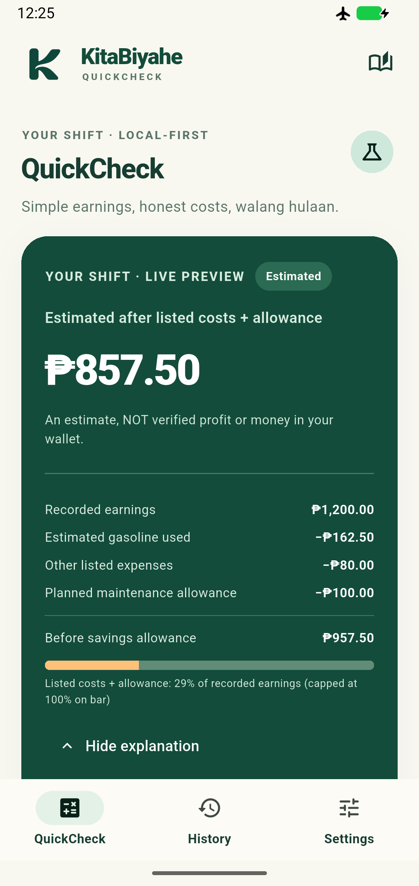
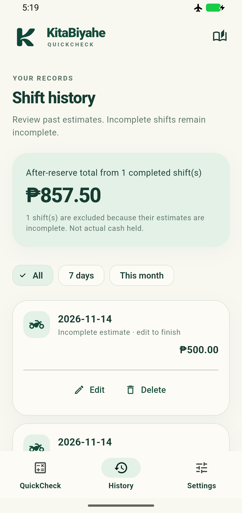

# KitaBiyahe

**A local-first shift earnings estimator for motorcycle-based riders**  
Academic MVP · version **0.4.3+4** · Windows x64 and Android

KitaBiyahe helps riders estimate what may remain from a shift after the operating costs they declare. It is designed for riders who want a clearer daily picture without treating a platform payout, wallet balance, or fuel refill as verified profit.

## What it does

- Enter earnings as one quick total or as itemized jobs, tips, bonuses, and adjustments.
- Estimate fuel from a manually entered consumed amount or from distance, fuel efficiency, and price per liter.
- Add other work costs and an optional planned maintenance reserve.
- Save, revisit, edit, and delete shifts; incomplete shifts remain marked incomplete.
- Keep records locally and export or restore a JSON backup, with Merge and confirmed Replace options.
- Set fuel units and motorcycle defaults for new shifts, with Taglish and reduced-motion settings.

The calculation is an estimate from entered values. It does not connect to ride platforms, track GPS, read receipts, verify expenses, reconcile cash and wallet balances, or establish profitability or business feasibility. It has no account or cloud sync. Records are local JSON, not application-encrypted; backup files need care.

The current limits are **100 saved shifts**, **40 itemized entries per shift**, and **1 MiB per imported backup**. See [Privacy](PRIVACY.md) and [Security](SECURITY.md) for storage, backup and reporting details.

## Screens

These are authentic application screenshots from the documented candidate build.

<table>
  <tr>
    <td align="center"> Fictional example result</td>
    <td align="center"> Saved shift history</td>
  </tr>
</table>

## Platform evidence

This is a bounded academic MVP, not a claim of universal device support. Recorded verification includes a Windows 11 x64 host and Android API 24 and API 37 emulators. The owner reports installing the corrected build on an Infinix GT 30 Pro running Android 16 and completing save, reopen, JSON export, and repeated Merge import steps. That phone result is owner-reported; see the exact scope and limits in [VERIFICATION](docs/VERIFICATION.md).

Intended targets are Windows x64 and Android 7/API 24 or later; Android compiles and targets API 36. The latest recorded automated run passed **63 tests** with no analyzer issues. Wider device coverage, complete accessibility acceptance and rider/business validation remain open.

## Run a packaged build

Download the Windows ZIP or Android APK from [release 0.4.3+4](https://github.com/BrentFordVRemerata/KitaBiyahe/releases/tag/v0.4.3%2B4). The release also provides the illustrated guide, source ZIP and SHA-256 checksums.

For a supplied Windows release ZIP, extract it completely and double-click **Start KitaBiyahe.bat** beside the complete **Windows** folder. Flutter and Visual Studio are not needed to run that packaged app. On Android, install the supplied signed APK through the normal installer; USB debugging is not needed. Export a backup before replacing an existing installation.

The repository contains source and developer scripts. A GitHub-generated source ZIP is not the runnable Windows package. Detailed app instructions are in the [user guide](docs/USER_GUIDE.md); exact developer prerequisites and build commands are in [BUILDING.md](docs/BUILDING.md).

## Project and authorship

Created by [Brent Ford V. Remerata](https://github.com/BrentFordVRemerata) as a solo Technopreneurship academic project. AI tools assisted planning, implementation drafts, tests, reviews and documentation. The [case study](docs/PORTFOLIO.md) explains the work, decisions and measured limits. No AI service is required to run the app.

## Build and project documents

- [Build and reproduce](docs/BUILDING.md) — verified toolchain, exact setup commands, scripts, and path guidance.
- [User guide](docs/USER_GUIDE.md) — using the packaged app and handling records.
- [Verification record](docs/VERIFICATION.md) — observed checks and explicit limits.
- [Privacy](PRIVACY.md) · [Security](SECURITY.md) · [Licensing](LICENSING.md) — data handling, reporting and attribution.
- [Architecture](docs/ARCHITECTURE.md) — current application and storage design.
- [Portfolio case study](docs/PORTFOLIO.md) — scope, choices, tradeoffs, regressions, and what remains unverified.
- [Roadmap](ROADMAP.md) — proposals only; not a promise or implementation record.
- [Changelog](CHANGELOG.md) · [Contributing](CONTRIBUTING.md) · [License](LICENSE).

Project-authored code and documentation are offered under [MIT](LICENSE). Third-party components and generated artwork have the scope and notices described in [LICENSING.md](LICENSING.md).
