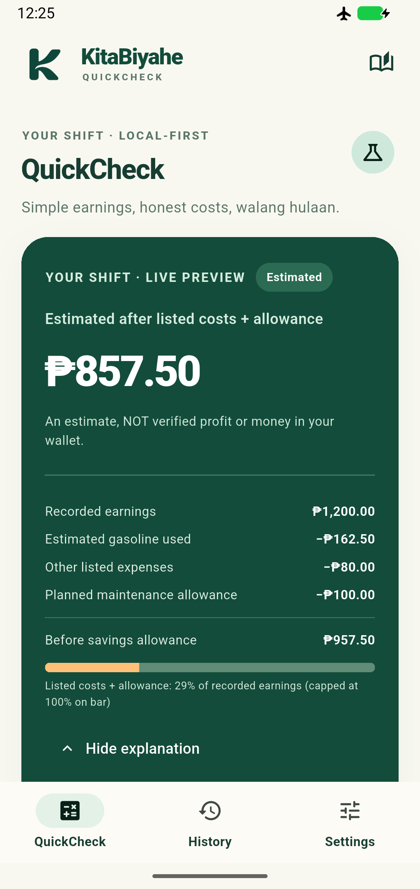
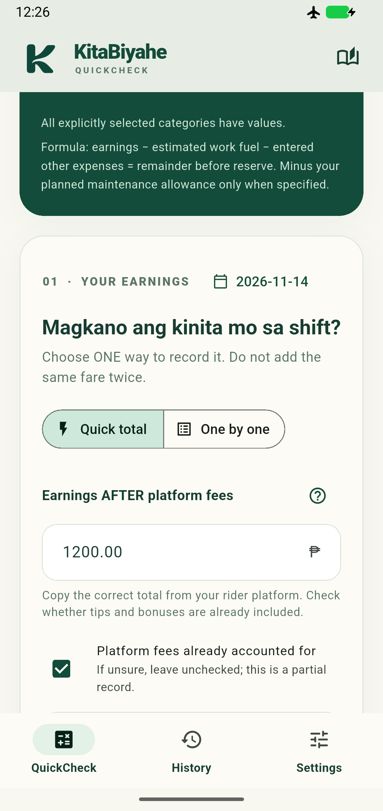
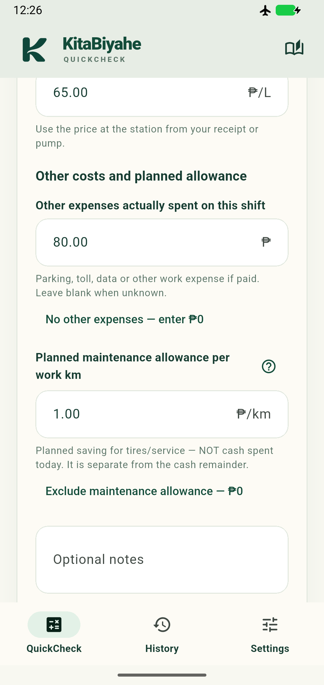
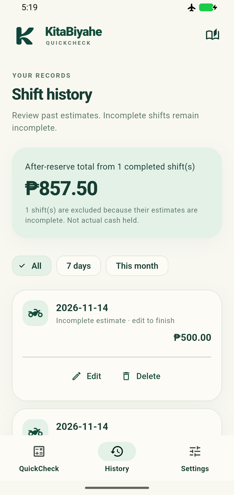
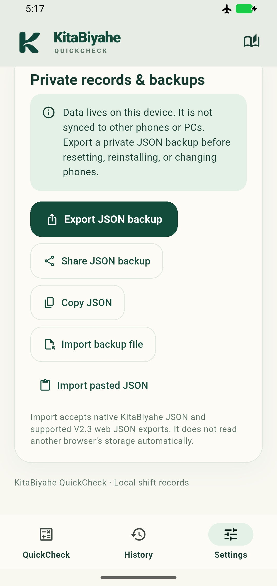

# KitaBiyahe QuickCheck

**Version 0.4.3+4 · Windows + Android package · November 15, 2026**

KitaBiyahe helps you estimate what remains from a work shift after the costs you enter. It works with saved information on your device; it has no account or cloud sync. Your figures are private financial information, so keep backup files somewhere you control.

## Choose your device

| Device | Start here |
|---|---|
| Windows 10 or 11, 64-bit | Extract the complete delivery ZIP. Double-click **Start KitaBiyahe.bat** at the package root, beside the `Windows` folder. Keep the entire `Windows` folder together. You do not need Flutter or Visual Studio to use the packaged app. |
| Android 7.0 or newer (API 24+) | In the Android delivery, tap the supplied APK in Downloads or a file manager. If prompted, allow that installer to install this user-selected APK, then tap **Install** and open KitaBiyahe. No USB cable or debugging setup is needed. |

This is a student project and an estimate tool, not verified profit, a wallet balance, a platform payout, or tax/accounting advice. Results are only as complete as the information you enter. Recorded checks cover one Windows 11 PC and Android 7/API24 and Android 17/API37 emulators. The owner reports installation, save, reopen, JSON export and repeated Merge import without duplicates on an Infinix GT 30 Pro running Android 16. See **VERIFICATION.md** for the exact scope and untested limits.

## First shift in three steps

1. In **QuickCheck**, enter earnings after platform fees. Or select **One by one** and list each earning source once.
2. Choose the fuel method you know, enter other work costs, and enter a planned maintenance allowance if you use one.
3. Review the result, then tap **Save this shift**. Only saved shifts are kept.

For a quick demonstration, tap the flask button **Try example figures**. The example is fictional and remains unsaved until you choose Save. It should show **₱857.50** after the listed costs and planned allowance. You can also import `examples/Fictional Shift Examples.json` using **Merge shifts** to add a complete and an incomplete example. Importing examples changes your saved history; export your own backup first if needed.

Use **History** to review, edit, or delete saved shifts. Use **Settings** for motorcycle defaults, fuel measurement, backups, language, and reduced motion. A new shift can remain incomplete if you do not yet know a cost; its result will not be included in completed after-reserve totals.

## Understand the estimate

The estimate subtracts declared work costs from earnings. For the example figures below:

| Entry | Calculation | Result |
|---|---:|---:|
| Earnings after fees |  | ₱1,200.00 |
| Fuel used | 100 km ÷ 40 km/L × ₱65/L | ₱162.50 |
| Other work costs |  | ₱80.00 |
| Remaining before reserve | ₱1,200 − ₱162.50 − ₱80 | ₱957.50 |
| Planned maintenance reserve | 100 km × ₱1/km | ₱100.00 |
| Remaining after reserve | ₱957.50 − ₱100 | **₱857.50** |

This is an estimate after listed costs, not money verified in your wallet. A reserve is planned money for future maintenance; it is not necessarily money spent today.

### Enter earnings once

Choose either **Quick total** or **One by one**. In itemized mode, tap **Add entry** and list each fee-adjusted earning once. For example, booking earnings ₱1,000 + a tip not yet counted ₱50 + an extra incentive ₱100 + an adjustment −₱20 = **₱1,130**. The app sums these entries; a value entered in Quick total is ignored while One by one is selected. Quick total and itemized entries are never added together. If a platform’s displayed amount already excludes commission or already includes a tip or bonus, do not subtract or add it again. A wallet or bank payout is money received from earnings already recorded, not a new earning to add.

### Fuel is fuel used

Under **How do you know your fuel cost?**, select one of the exact fuel choices for a shift:

- **Fuel amount:** enter the estimated value of gasoline consumed while working.
- **From distance:** enter work distance, your motorcycle’s fuel efficiency, and price per liter. KitaBiyahe calculates distance ÷ km/L × price per liter.
- **Not sure yet:** leave fuel unknown and save the shift incomplete until you can fill it in.

A ₱300 refill is a purchase, not automatically ₱300 of fuel used for that shift. If gasoline remains in the tank, the refill amount and shift consumption differ. Never add both the manual fuel estimate and the distance calculation for the same shift. The app has no universal default motorcycle km/L; use your own measurement, a reliable reference, or leave it unknown.

### Blank and zero mean different things

| Entry | Meaning |
|---|---|
| Blank / unknown | You do not know the amount yet. KitaBiyahe does not treat it as zero or claim a complete after-cost total. |
| ₱0.00 | You know the amount is zero, or intentionally chose to exclude a reserve. |

For example, an earnings-only shift of ₱500 with unknown fuel must not deduct ₱0 fuel. It can be saved for later completion, but it is labeled incomplete and excluded from History’s completed after-reserve total. You may edit it later when you know the missing costs.

## Save, revisit, and finish later

- **Save** a shift to keep it on this device. You can edit a saved record from **History**.
- You can save earnings before all costs are known. Open that history entry and add the missing information later.
- Your QuickCheck draft survives switching among QuickCheck, History, and Settings during that open session. Confirm any prompt before replacing that draft or closing the app. An unsaved draft is lost if the app closes or is stopped.
- The app allows up to **100 saved shifts**. Delete a record only after considering whether you need it; export a backup first if you want to retain it.
- Settings are suggestions for new shifts. Changing fuel efficiency, price, reserve, units, language, or reduced-motion preference does not silently recalculate old records. Each saved shift retains its original assumptions.

## Motorcycle settings and fuel measurement

Open **Settings**, then the **Fuel efficiency units** section, to choose a display unit, set your own fuel efficiency and fuel price, and set a reserve per kilometer. Leave unknown values blank. The app supports km/L, MPG (US), MPG (UK), and L/100 km; US and UK gallons are different units. Values convert when you change the display unit.

Tap **Save motorcycle settings** before leaving Settings to keep edits there. Switching tabs does not save unsaved Settings edits.

To estimate your own km/L, use **Measure my km/L** with two consecutive, consistent full refills. Record the odometer at each refill and the liters added at the second refill. The calculation is distance between readings ÷ liters added at the second refill. Do not top up beyond the normal fill level. Real traffic, loads, and riding conditions change consumption, so one interval is an estimate; repeated readings are more representative.

## Back up and restore your data

Open **Settings → Private records & backups**. Export a JSON backup regularly and before resetting a device, reinstalling the app, or changing phones/computers. A backup contains your entered shift amounts and settings; store and share it carefully.

| Action | What it does |
|---|---|
| **Export JSON backup** | Saves a JSON file using the platform’s save picker. On Android, choose a folder and tap **Save**. Canceling does not create a backup. |
| **Share JSON backup** (Android) | Opens the device’s sharing options. Choose only a destination you trust. A sharing app must be installed; direct Export does not require one. |
| **Copy JSON** | Copies the backup text to the clipboard. Keep it private and avoid pasting it into public chats or documents. |
| **Import backup file** | Opens a file picker. On Windows choose a `.json` file; on Android choose the backup from the system file picker. |
| **Import pasted JSON** | Imports backup text that you deliberately copied to the clipboard. |

After choosing a valid backup, select one of these options:

- **Merge shifts** adds records with new IDs and keeps the current device’s motorcycle settings. Existing matching IDs are not duplicated. It does not detect two separately-created records as the same shift.
- **Replace all** overwrites all current shifts and motorcycle settings with the backup after confirmation. Export a backup of the current device first if you may need those records.
- **Cancel** leaves the current data as-is.

Only supported, valid backups within the limits are imported: at most **1 MiB** and **100 shifts**. If the file is malformed, too large, or otherwise rejected, current records are retained and an error is shown. The native schema-1 JSON backup can be restored on another KitaBiyahe installation; a supported version-22 web export can also be imported. Older web-app browser storage is not imported automatically; export a JSON file from that app first.

### Where records live

Records are stored locally by the operating system for this app. On Windows the observed data file is under `%APPDATA%\ph.kitabiyahe\kitabiyahe\kitabiyahe_data_v1.json`. Keep the app’s data files intact. On Android, use **Settings → Export JSON backup** and the system save picker; ordinary Android app-private records are not presented as a file-manager folder. The app does not sync records to another device. Platform cloud backup and device-transfer extraction for the app’s files are disabled, so rely on your own exported JSON backup.

### Update or move the app

Before updating or moving devices, export and check a backup. Install the Android update over the existing app when possible; the same app identity and signing key are required. If Android says the update is incompatible, do not uninstall the existing copy until you have a verified backup. Uninstalling may remove local records. A release signed with a different key cannot update the installed copy. For Windows, keep the whole package folder together; the packaged app uses the Windows account’s existing local data.

## Limits and support

The Windows application is a local student build without a purchased publisher-signing certificate. Windows may show an unknown-publisher warning. Confirm the supplied SHA-256 checksum and the source of the ZIP before running it. If your institution blocks it, contact the project author or use an approved review machine; do not disable Windows protection.

KitaBiyahe works only with numbers you enter. It does not connect to a ride platform, track GPS, reconcile cash versus wallet, read receipts, verify expenses, or calculate taxes. No rider research, profitability, or business-feasibility result is claimed. Treat invalid or incomplete records as needing review; the app does not recover unsaved form entries after closure.

This is a solo TECHNO101 student project created with AI assistance and developer review. For the source rebuild instructions, see **Source/README.md**; using the packaged Windows app or Android APK does not require Flutter or Visual Studio. No public upload or commercial terms are stated by this guide.
